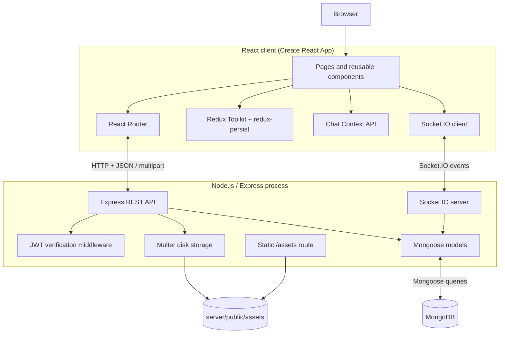
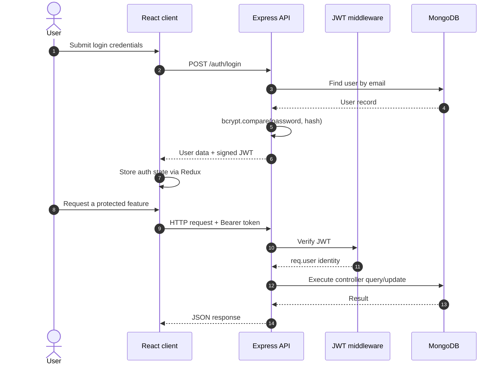
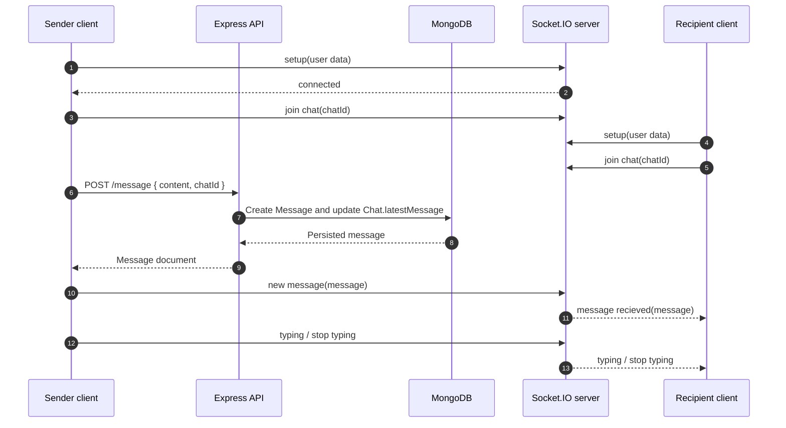

# ConnectMe architecture

This document describes the source layout and the two main runtime paths: authenticated HTTP requests and real-time chat events.

## Component diagram

## Main responsibilities

| Component | Responsibility |
|---|---|
| React pages/components | Login, feed, profile, saved posts, chat, forms, and reusable UI |
| Redux Toolkit | Login state, user, JWT, theme mode, and feed posts |
| redux-persist | Persists the Redux store in browser storage |
| Chat Context | Selected chat, chat list, user and in-session notification state |
| Express routes/controllers | Exposes authentication, user, post, chat, message, and saved-post operations |
| JWT middleware | Verifies bearer tokens on protected HTTP routes |
| Mongoose | Maps user, post, saved-post, chat, and message documents to MongoDB |
| Multer | Receives multipart image uploads and writes them to disk |
| Static assets route | Serves local images from `/assets` |
| Socket.IO | Joins user/chat rooms and relays typing and message events |

## HTTP authentication and request flow

The current implementation signs JWTs without an explicit expiry. Also, some controllers still trust IDs supplied in request bodies or URL parameters rather than enforcing that the target resource belongs to the authenticated user. See the security section in the root README.

## Real-time messaging flow

The message is written through the REST API first. Socket.IO then relays the newly persisted message to recipient user rooms. The current socket connection does not authenticate the handshake; this must be addressed before deployment.

## Data model overview

- **User:** name, email, password hash, profile image path, friends, location, occupation, and placeholder profile metrics.
- **Post:** author identifiers/name, text, image path, likes map, and timestamps.
- **Saved:** user ID, post reference, category, and timestamps.
- **Chat:** members, group/direct-chat flag, latest message, optional group name/admin.
- **Message:** sender, content, chat reference, read-by list, and timestamps.

The comments field on `Post` is declared as an array of ObjectId references, but the unfinished comment controller constructs embedded comment objects. The comments feature needs a consistent data model before it is enabled.

## Runtime ports and configuration

- React development server: `http://localhost:3000`.
- Express and Socket.IO: `http://localhost:3001` when using the supplied `.env.example`.
- MongoDB: configured through `MONGO_URL`.
- JWT signing/verification: configured through `JWT_SECRET`.

The frontend currently hardcodes the backend origin in multiple components. Centralizing it in environment-based configuration is a roadmap item.
