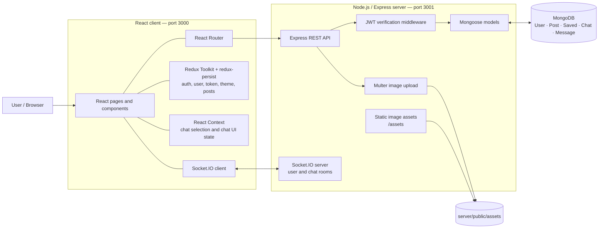

# ConnectMe — Social Media & Real-Time Chat

ConnectMe is a full-stack social networking application where users can create image-based posts, connect with other users, save posts into categories, and communicate through real-time chats.

The project uses **React** for the client, **Node.js and Express** for the API, **MongoDB with Mongoose** for persistence, and **Socket.IO** for real-time communication.

> **Project status:** This repository is a learning/portfolio project. The documentation below describes the current source code and calls out features that are partial or require hardening. It is not presented as a production-ready social network.

## Contents

- [What the app does](#what-the-app-does)
- [Architecture](#architecture)
- [Technology stack](#technology-stack)
- [Repository layout](#repository-layout)
- [Getting started](#getting-started)
- [Environment configuration](#environment-configuration)
- [API overview](#api-overview)
- [How real-time chat works](#how-real-time-chat-works)
- [Screenshots and demo evidence](#screenshots-and-demo-evidence)
- [Current limitations and security work](#current-limitations-and-security-work)
- [Roadmap](#roadmap)

## What the app does

### Implemented application areas

- **Accounts:** registration and login; passwords are hashed with `bcrypt`, and successful login returns a signed JWT.
- **Social feed:** create text/image posts and browse feed posts.
- **Post interactions:** like and unlike posts.
- **Profiles and connections:** view user profiles, search for users, and add/remove friends.
- **Saved posts:** save posts under one of the available categories — `personal`, `funny`, or `motivational` — and filter the saved-post view by category.
- **Real-time chat:** one-to-one and group chat flows, message history, typing events, and Socket.IO message delivery.
- **Appearance:** switch between light and dark themes.
- **Responsive UI:** layouts adapt for smaller and larger screens.

User lookup uses a case-insensitive MongoDB regular-expression query against first and last names. It is a **user search** feature; it is not a general full-text search engine.

### Features that are partial or not currently complete

The repository also contains UI or controller code for comments and message notifications, but those flows are not fully wired end to end. The comments routes are commented out, and the notification menu rendering is commented out. See [Current limitations and security work](#current-limitations-and-security-work) before describing these as completed features.

## Architecture

The application has two main runtime processes:

1. A React single-page application served by Create React App.
2. An Express API server that connects to MongoDB and hosts a Socket.IO server on the same HTTP server.



The diagram is also available in [docs/ARCHITECTURE.md](docs/ARCHITECTURE.md), which includes the main request and messaging flows.

## Technology stack

| Layer | Technologies | Purpose |
|---|---|---|
| Frontend | React 18, Create React App | Single-page application |
| UI | Material UI, Chakra UI, Emotion, Framer Motion | Components, styling, and motion |
| Navigation | React Router 6 | Client-side routing |
| State management | Redux Toolkit, React Redux, redux-persist | Authentication, user, theme, and feed state |
| Local UI state | React Context API | Chat selection, chat list, and notification state |
| Forms and validation | Formik, Yup, React Dropzone | Login/registration forms and image selection |
| HTTP | Fetch API, Axios | Client-to-server REST requests |
| Real-time | Socket.IO client and server | Chat messages and typing events |
| Backend | Node.js (ES modules), Express 4 | REST API and HTTP server |
| Database | MongoDB, Mongoose 7 | Document persistence and data models |
| Authentication | JSON Web Token (`jsonwebtoken`), `bcrypt` | Token-based API authentication and password hashing |
| Uploads | Multer | Local image uploads |
| Middleware / logging | Helmet, CORS, Morgan, body-parser | Security headers, cross-origin handling, request logging, and request parsing |

The repository includes `gridfs-stream` and `multer-gridfs-storage` dependencies, but the current upload implementation uses Multer disk storage and serves files from `server/public/assets`.

## Repository layout

```text
ConnectMe/
├── client/
│   ├── public/
│   ├── src/
│   │   ├── components/       # Shared UI and chat components
│   │   ├── Context/          # Chat context provider
│   │   ├── config/           # Chat helper functions
│   │   ├── scenes/           # Login, feed, profile, saved posts, chat pages
│   │   ├── state/            # Redux Toolkit slice
│   │   ├── App.js
│   │   └── index.js
│   └── package.json
├── server/
│   ├── controllers/          # Request handlers
│   ├── data/                 # Example seed data (insertion is not enabled)
│   ├── middleware/           # JWT verification
│   ├── models/               # Mongoose schemas
│   ├── public/assets/        # Uploaded and bundled image assets
│   ├── routes/               # Express routers
│   ├── .env.example
│   ├── index.js              # Express and Socket.IO entry point
│   └── package.json
├── docs/
│   ├── ARCHITECTURE.md
│   └── SCREENSHOTS.md
└── README.md
```

## Getting started

### Prerequisites

- Node.js 18 or later and npm.
- A running MongoDB instance, either local or hosted (for example, MongoDB Atlas).
- Git.

### 1. Clone the repository

```bash
git clone https://github.com/AshwinNigam205/ConnectMe.git
cd ConnectMe
```

### 2. Configure the backend

```bash
cd server
```

Create a local environment file from the example:

```bash
# macOS / Linux
cp .env.example .env

# Windows PowerShell
Copy-Item .env.example .env
```

Edit `server/.env` and set a valid MongoDB connection string and a private JWT signing secret. The example file uses port `3001` because the current client code calls `http://localhost:3001` directly.

Install dependencies and start the API:

```bash
npm install
npm start
```

The API should listen on `http://localhost:3001` and log a successful MongoDB connection when the database is reachable.

### 3. Start the frontend

Open a second terminal from the repository root:

```bash
cd client
npm install
npm start
```

Create React App should open the app at `http://localhost:3000`.

### 4. Create an account and try the app

Register through the application UI, then sign in. The app's main routes are:

| Route | Purpose |
|---|---|
| `/` | Login and registration |
| `/home` | Feed and post creation |
| `/profile/:userId` | User profile and posts |
| `/chat` | One-to-one and group chat |
| `/saved/:userId` | Saved posts and category filter |

### Image storage

The backend currently writes uploaded images to `server/public/assets` and exposes that directory under `/assets`. Ensure the server process can write to this directory. This is a simple local-development approach; it should be replaced with managed object storage for a deployed application.

## Environment configuration

Create `server/.env` (do not commit it):

| Variable | Required | Example | Description |
|---|---:|---|---|
| `PORT` | No | `3001` | Express/Socket.IO listening port. Keep `3001` unless the frontend API URLs are also changed. |
| `MONGO_URL` | Yes | `mongodb://127.0.0.1:27017/connectme` | MongoDB connection string. |
| `JWT_SECRET` | Yes | `replace-with-a-long-random-secret` | Secret used to sign and verify JWTs. Use a unique, high-entropy value. |

Generate a private secret rather than reusing the example value. Never commit `.env`, real credentials, database URLs, or tokens.

**Configuration note:** The frontend currently hardcodes `http://localhost:3001` in its API and Socket.IO calls. The backend port is configurable, but changing it alone will break the client. A future improvement is to centralize the API and socket base URLs in frontend environment variables.

## API overview

All routes below are mounted on the backend origin `http://localhost:3001`. Except registration and login, the listed API routes use the JWT verification middleware.

| Area | Method | Endpoint | Purpose |
|---|---|---|---|
| Authentication | `POST` | `/auth/register` | Register a user; accepts multipart form data and an optional profile image |
| Authentication | `POST` | `/auth/login` | Verify credentials and return a JWT |
| Users | `GET` | `/users/search?username=...` | Search users by name |
| Users | `GET` | `/users/:id` | Retrieve a user profile |
| Users | `GET` | `/users/:id/friends` | Retrieve a user's friends |
| Users | `PATCH` | `/users/:id/:friendId` | Add or remove a friend relationship |
| Posts | `POST` | `/posts` | Create a post; supports an image upload |
| Posts | `GET` | `/posts` | Retrieve feed posts |
| Posts | `GET` | `/posts/:userId/posts` | Retrieve posts associated with a user |
| Posts | `PATCH` | `/posts/:id/like` | Like or unlike a post |
| Chat | `POST` | `/chat` | Find or create a one-to-one chat |
| Chat | `POST` | `/chat/group` | Create a group chat |
| Chat | `GET` | `/chat` | List chats for the authenticated user |
| Chat | `PUT` | `/chat/rename` | Rename a group chat |
| Chat | `PUT` | `/chat/groupadd` | Add a user to a group chat |
| Chat | `PUT` | `/chat/groupremove` | Remove a user from a group chat |
| Messages | `POST` | `/message` | Save a chat message |
| Messages | `GET` | `/message/:chatId` | Retrieve messages for a chat |
| Saved posts | `POST` | `/saved` | Save a post with a category |
| Saved posts | `GET` | `/saved/:id` | Retrieve saved-post records for a user |

This table reflects route declarations in the current source. It does not imply that every endpoint has complete authorization, validation, or production-grade error handling.

## How real-time chat works

1. The client establishes a Socket.IO connection to the backend.
2. The client emits `setup` with the logged-in user; the server joins a room identified by that user's ID and emits `connected`.
3. When a conversation is opened, the client emits `join chat` with the chat ID.
4. Typing state is sent with `typing` and `stop typing` events.
5. The client saves a message through `POST /message`.
6. After the REST call succeeds, the client emits `new message`. The server sends `message recieved` to the other participants' user rooms.

The REST API persists messages in MongoDB; Socket.IO provides the live delivery signal. See [docs/ARCHITECTURE.md](docs/ARCHITECTURE.md) for a sequence diagram.

## Screenshots and demo evidence

As an initial sample output, the current user-search endpoint returns this response shape. Values below are placeholders, not data captured from a live database:

```json
{
  "users": [
    {
      "_id": "<MongoDB ObjectId>",
      "firstName": "<first name>",
      "lastName": "<last name>",
      "email": "<email address>",
      "picturePath": "<profile-image-filename>"
    }
  ]
}
```

Example request (replace the token with a JWT returned by login):

```bash
curl "http://localhost:3001/users/search?username=alex" \\
  -H "Authorization: Bearer <JWT>"
```

Recommended captures:

1. `login.png` — login and registration screen.
2. `feed.png` — feed with a post and the light/dark theme.
3. `profile.png` — profile and friend list.
4. `saved-posts.png` — saved-post page with a category selected.
5. `chat.png` — an active conversation with messages.

See [docs/SCREENSHOTS.md](docs/SCREENSHOTS.md) for capture guidance and the suggested README embedding format.

## Current limitations and security work

The following items were identified by static inspection of the uploaded source. They should be addressed before presenting the project as production-ready.

### Functional and reliability gaps

- **Comments are incomplete:** comment routes are commented out, the post schema models comments as ObjectId references, and the current UI's add-comment control is not connected to a working request.
- **Notifications are partial:** incoming-message notification state exists, but the notification dropdown/menu implementation is commented out.
- **Friend removal needs correction:** the friend-side filter in `addRemoveFriend` compares a variable with itself, which can clear the other user's friend list rather than removing only the intended relationship.
- **Saved-post handling needs validation:** duplicate saves are not prevented, and saved-post retrieval should validate the requested user and referenced post IDs.
- **Profile analytics are placeholders:** `viewedProfile` and `impressions` are initialized with random values; they are not calculated from real activity.
- **Automated tests are missing:** the server test script is only a placeholder, and there is no meaningful backend test suite.

### Security hardening required

- **Protect user data:** `GET /users/:id` currently returns the full user document. It should explicitly exclude password hashes and return only public profile fields.
- **Enforce ownership on the server:** post and saved-post handlers accept `userId` from the request body. Derive the acting user from the verified JWT (`req.user`) instead of trusting a client-supplied identity.
- **Authorize chat access:** message-history retrieval and group membership changes should verify that the authenticated user belongs to the chat and has the required group permissions.
- **Authenticate Socket.IO connections:** the current socket setup trusts the client-supplied user object. Verify a JWT during the socket handshake and derive the room identity from the verified token.
- **Add JWT expiry and lifecycle handling:** tokens are currently signed without an explicit expiration. Add expiry, refresh/re-authentication behavior, and logout/token invalidation as appropriate.
- **Validate uploads on the server:** enforce file size and MIME/type allowlists, generate safe server-side filenames, and consider malware scanning. Client-side file-picker restrictions are not a security boundary.
- **Add request controls:** validate and sanitize inputs, rate-limit authentication and search endpoints, and configure CORS for the intended frontend origin.
- **Review browser token storage:** Redux state is persisted in browser storage. Consider the XSS implications and evaluate a secure, HttpOnly cookie-based session design.

## Roadmap

A practical order for the next development iterations:

| Priority | Improvement | Expected outcome |
|---|---|---|
| High | Fix identity, ownership, and chat-membership authorization | Prevent IDOR-style access and unauthorized actions |
| High | Exclude sensitive fields; validate uploads and inputs | Reduce data exposure and upload risk |
| High | Add Socket.IO authentication and JWT expiration | Secure real-time connections and token lifecycle |
| High | Add backend and frontend tests | Make core workflows verifiable and regressions easier to catch |
| Medium | Move API/socket URLs to environment configuration | Support local, staging, and production environments cleanly |
| Medium | Complete comments and notifications | Finish partially implemented user-facing flows |
| Medium | Add pagination, indexes, and duplicate-save prevention | Improve performance and data consistency |
| Medium | Move uploads to object storage | Support reliable deployment and scalable media delivery |
| Later | Add CI, deployment documentation, monitoring, and structured logs | Improve maintainability and operational readiness |

## Contributing

For changes, create a focused branch, describe the behavior being changed, and include tests or reproducible steps where possible. Do not commit `.env` files, secrets, user data, or private screenshots.

## License

No explicit license file was present in the supplied repository. Add a `LICENSE` file before presenting the project as open source; without one, reuse and redistribution permissions are not clearly granted.
